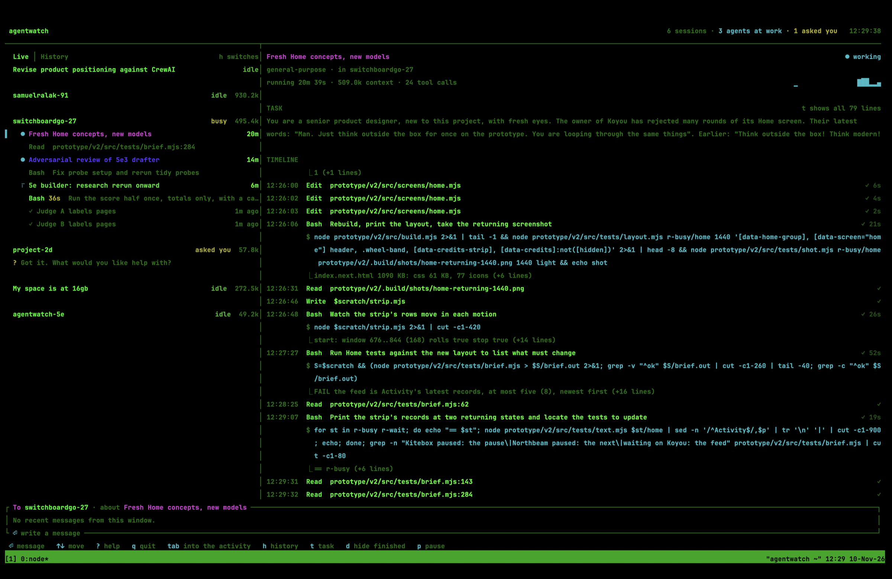

# agentwatch

See what your Claude Code subagents are doing, live, and message the main agent while you
watch.



## Why

1. **Show what subagents are doing**, live, for every Claude Code session on the machine.
2. **Hide nothing.** The point is visibility: text wraps, it is never cut.
3. **Message the main agent** while looking at a subagent.

## Install

Needs Node.js 22.15 or later. Tested on macOS only, with Claude Code 2.1.316 to 2.1.322.

```sh
./install.sh    # once, from a clone of this repository
agentwatch      # whenever you want to watch
```

`install.sh` builds agentwatch, links the `agentwatch` command into `~/.local/bin`, and adds
its hooks to `~/.claude/settings.json`, keeping a backup and leaving everything else as it
is. Running sessions pick the hooks up without a restart.

## Keys

| Key | Does |
| --- | --- |
| `↑` `↓` | select a session or an agent |
| `⏎` | write a message; `⏎` again sends it |
| `tab` | move into the activity; `↑` `↓` then select entries |
| `→` | open the selected entry in full |
| `←` `esc` | back |
| `h` | switch between running sessions and past ones |
| `?` | all keys |
| `q` | quit |

A trackpad or mouse wheel scrolls.

## Messages

A message goes to the session's main agent. It wakes an idle session and reaches a busy one
at its next step. Claude Code shows it to the agent as hook feedback, not as you typing, so
it is an instruction, not an approval.

## More

- [Usage](docs/usage.md)
- [Security](docs/security.md)
- [How it works](docs/architecture.md)
- [Development](docs/development.md)
- [Changelog](CHANGELOG.md)

To remove agentwatch: `agentwatch hooks uninstall`.

MIT licensed. See [LICENSE](LICENSE).
